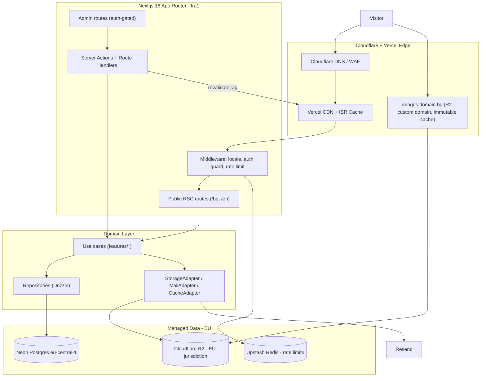
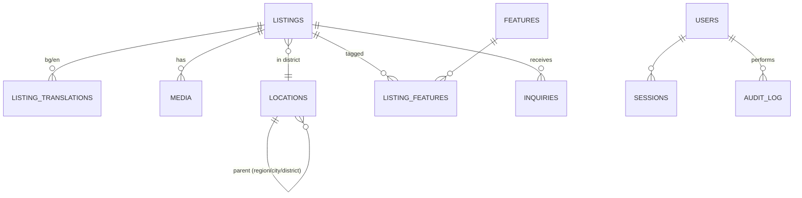

# Real Estate Listings Platform ("Estate Template")

A production-ready, bilingual property-listings platform that doubles as a reusable open-source template. Public site is read-heavy and near-fully cached; a hardened admin console is the only write path.

## Decisions locked from your answers

- Favorites: anonymous, device-local (no public accounts). Auth exists only for staff.
- Hosting: managed PaaS (Vercel + Neon Postgres + Cloudflare R2), Frankfurt region for Bulgarian latency.
- Languages: Bulgarian + English, locale-prefixed URLs with `hreflang`.

## Requirements this implementation satisfies

### Functional

- Listings for every asset class: apartment, house, floor of house, land/plot, office, retail, industrial, garage, hotel — each with `dealType` of sale or rent, and full attribute set (price, currency, area, land area, floor/of, rooms, bedrooms, bathrooms, construction type, year built, heating, furnishing, energy label, exposure, condition, maintenance fee, deposit for rentals, availability date).
- Rich media per listing: ordered photo gallery, floor plans, documents, optional YouTube/Vimeo embed, per-image alt text (bilingual, for SEO + a11y).
- Hierarchical, slugged locations: country → region (oblast) → city → district (kvartal), so URLs like `/bg/prodazhba/apartamenti/sofia/lozenets` are real indexable pages.
- Visitor browsing: faceted search (deal type, kind, location, price range, area range, rooms, features), sorting (newest, price asc/desc, price per m²), map view, keyset-paginated grid, "similar listings", full-text search over title/description/reference ID.
- Favorites / watchlist: anonymous, persisted in `localStorage`, with a counter badge, dedicated `/favorites` page, side-by-side compare view, and a shareable link that encodes the selected listing IDs.
- Lead capture: per-listing inquiry form and callback request, stored in DB + emailed to the agency; spam-protected and rate-limited.
- Admin console at `/admin`: email+password login with TOTP 2FA, listing CRUD with draft → published → reserved → sold lifecycle, drag-and-drop multi-upload with reordering, map pin picker, bulk actions, feature/location taxonomy management, inquiry inbox with statuses, and an immutable audit log of who changed what.
- SEO surface: per-locale metadata, JSON-LD, dynamic sitemaps, OG images, canonical/`hreflang` handling.

### Additions I recommend (beyond your list, all cheap and high-value)

- Public reference ID per listing (like the reference numbers on yavlena.com) so agents can quote "ID 174251" over the phone — a stable, human-friendly lookup separate from the DB primary key.
- Mortgage/credit calculator on the detail page (pure client-side, zero backend cost) — the reference site has one and it is a strong engagement driver.
- Saved-search email alerts are deliberately deferred (needs accounts); instead ship an RSS/Atom feed per search, which gets the same value with zero auth.
- Draft previews via signed preview tokens so an agent can share an unpublished listing with an owner.
- CSV/JSON export + import of listings so the agency is never locked in, and so template users can bulk-seed.

### Non-Functional

- Flat performance from 5 to 50,000 listings: detail pages are statically generated with ISR and tag-based invalidation; list pages use keyset (cursor) pagination — never `OFFSET`; every filter combination is backed by a composite or GIN index; facet counts come from a periodically refreshed materialized view rather than live `COUNT(*)`. Verified by seeding 50,000 synthetic listings and asserting p95 query time in CI.
- High availability: Vercel's global anycast network with automatic region failover, Neon multi-AZ storage. Critically, the public site degrades gracefully — because pages are ISR-cached, a total database outage still serves stale content instead of a 500.
- SEO: SSR/SSG only (no client-rendered content), `<1s` TTFB from cache, Core Web Vitals budget enforced in CI (LCP < 2.0s, CLS < 0.05, INP < 200ms), `RealEstateListing`/`Offer`/`BreadcrumbList`/`Organization` JSON-LD, split sitemaps (max 45k URLs each) + sitemap index, robots rules that index the whitelisted facet routes and `noindex` the long-tail combinations to avoid crawl-budget waste.
- Security: TLS 1.3 everywhere with HSTS preload; session cookies `httpOnly` + `Secure` + `SameSite=Lax` + `__Host-` prefix; Argon2id password hashing; TOTP 2FA mandatory for admins; distributed rate limiting on login (per-IP and per-account), on inquiry submission, and on search; exponential lockout backoff; strict CSP with nonces; `X-Frame-Options`, `Referrer-Policy`, `Permissions-Policy`; Zod validation on every boundary; presigned-URL uploads with MIME sniffing and size caps so raw files never touch the app server; audit logging.
- GDPR/EU: all data (DB, object storage, functions) resides in EU regions; cookie-consent gate before any analytics; documented retention policy for inquiries; IPs stored only as salted hashes.
- Accessibility: WCAG 2.2 AA — keyboard-navigable gallery and filters, visible focus rings, real labels, `prefers-reduced-motion` respected.
- Observability: Sentry for errors, Vercel Analytics for Web Vitals, uptime monitoring with alerting, structured logs.
- Cost predictability: image derivatives are precomputed at upload time, so serving cost does not scale with per-request transformations.

## High-level system design



Request flow in one line: cached HTML from the edge for 99% of traffic, database touched only on cache miss or admin write, images bypass the app entirely and stream from R2 through Cloudflare.

### Layering (SRP) and how the code stays DRY

```
src/
  app/                    # routes = thin adapters only: parse input, call use case, render
    [locale]/(public)/...
    [locale]/(admin)/...
    api/                  # webhooks, sitemap, feeds, presigned-upload endpoint
  features/               # one folder per bounded context = one reason to change
    listings/{use-cases,schemas,mappers,components}
    media/{pipeline,presign}
    inquiries/
    search/{query-builder,facets}
    favorites/            # client-only store
    auth/
  server/
    db/{schema,migrations,seed}
    repositories/         # the ONLY place Drizzle queries live
    adapters/{storage,mail,cache}
  lib/                    # framework-agnostic utils, Result type, formatters
  config/site.ts          # single source of branding/feature flags (template hook)
  i18n/messages/{bg,en}.json
```

Design patterns, each earning its place:

- Repository — all SQL lives in `server/repositories/*`; use cases never import Drizzle. Makes the 50k-row performance work a single-file concern and lets template users swap Postgres.
- Adapter/Strategy — `StorageAdapter` (R2 | S3 | local disk) and `MailAdapter` (Resend | SMTP | console). This is what makes the template deployable on a €5 VPS without touching feature code.
- Builder — `SearchQueryBuilder` composes filter fragments into one Drizzle query instead of a nest of conditionals; each filter is a small, unit-testable function.
- Mapper/DTO — DB rows are mapped to view models at the boundary, so we never leak internal columns (e.g. exact address of a hidden-address listing) into the client bundle.
- Result type — `Result<T, E>` for expected failures (validation, not-found, rate-limited); exceptions reserved for true bugs.
- Zod schema as single source of truth — one schema drives the client form (react-hook-form), the server action (next-safe-action), and the TypeScript types. No duplicated validation.

Deliberately _not_ doing: no DI container, no CQRS, no event bus, no microservices. Those would be over-engineering for this scope.

### Data model (SQL, normalized where it matters)



- `listings` holds all filterable/sortable numeric + enum columns (denormalized on purpose so every facet is one indexed table scan-free lookup), plus `price_per_sqm` as a generated column.
- `listing_translations(listing_id, locale, title, description, slug)` keeps i18n out of the hot table and gives per-locale slugs.
- `media` stores the R2 key, intrinsic width/height, and a tiny blur placeholder — width/height in the DB is what eliminates layout shift.
- Key indexes: composite `(status, deal_type, property_kind, city_id, price)`, `(published_at DESC, id DESC)` for keyset paging, GIN on a generated `tsvector`, `pg_trgm` on title + reference ID for typo-tolerant search.

### Why SQL (Postgres), not NoSQL

The core query is a multi-dimensional range + equality filter with sorting and facet counts ("apartments for sale in Sofia, 120–250k EUR, 60–90 m², 2+ rooms, with a garage, sorted by price/m²"). Postgres answers that with one composite index; a document store would need a denormalized index per access pattern or a bolted-on search engine. We also get transactional publish operations, referential integrity across listings/media/locations, native full-text search, and generated columns — all on a $0 free tier. Postgres also keeps the door open for PostGIS if map-radius search ("within 2 km of this point") is added later. No part of this workload benefits from schemaless storage.

## Hosting, storage, and the image pipeline

- Compute + CDN: Vercel, functions pinned to `fra1` (Frankfurt) — lowest latency to Bulgaria while staying EU. Zero-config ISR, atomic deploys with instant rollback, automatic TLS certs, built-in WAF and DDoS mitigation. Note: the Hobby plan is explicitly non-commercial per [Vercel's pricing FAQ](https://vercel.com/pricing), so a real agency site needs Pro.
- Database: [Neon](https://neon.com/pricing) Postgres in `eu-central-1`. Chosen over Supabase mainly for scale-to-zero (near-zero cost while the catalog is small) and database branching, which gives every preview deployment its own isolated DB.
- Images/files: [Cloudflare R2](https://developers.cloudflare.com/r2/pricing/), EU jurisdiction, exposed on `images.yourdomain.bg`. R2's zero egress fee is the decisive factor — image bandwidth is the single largest cost driver for a photo-heavy site, and routing it around Vercel also keeps Vercel's Fast Data Transfer usage low.
- Image pipeline (this is the cost-and-speed lever): admin browser uploads the original straight to R2 via a short-lived presigned PUT (server never proxies bytes) → a server action runs `sharp` to produce a fixed derivative set (320/640/1024/1600 px in AVIF + WebP) plus a blur placeholder → derivatives are written under content-hashed, immutable keys → a custom `next/image` loader maps to those keys. Because derivatives are precomputed once, we pay no per-request transformation fee and no Vercel Image Optimization metering, and page speed is identical whether the catalog has 5 or 5,000 listings. ([Cloudflare Images](https://developers.cloudflare.com/images/pricing/) on-the-fly transforms would be the fallback: 5,000 unique transforms/month free, then $0.50/1,000.)
- DNS + registrar: Cloudflare (free DNS, free proxy, free universal SSL, at-cost domains via [Cloudflare Registrar](https://www.cloudflare.com/products/registrar/)). A `.bg` domain must come from a Bulgarian registrar.
- Rate limiting: [Upstash Redis](https://upstash.com/pricing/redis) (serverless, HTTP-based — works from edge middleware; free tier covers our volume).
- Email: Resend for inquiry notifications; free tier is sufficient at launch.
- Errors/uptime: Sentry free tier + a free uptime monitor.

## Cost estimate (monthly)

### Launch: ~50 listings, ~5k visits/month

- Domain `.bg`: ~€29.60/year ≈ **€2.47/mo** ([Jump.BG](https://www.jump.bg/domains/bg), ~€32.40/yr at [ICDSoft](https://www.icdsoft.com/bg/domains/bg) without hosting). A `.com` instead is ~$10.44/yr ≈ **$0.87/mo** at Cloudflare Registrar at-cost.
- TLS/SSL: **$0** — auto-provisioned and renewed by Vercel and Cloudflare.
- Vercel Pro: **$20/mo** (includes $20 of usage credit, 1 TB Fast Data Transfer, 10M edge requests, 1M function invocations — all far above launch traffic). Hobby would be $0 but is non-commercial.
- Neon: **$0** on Free (0.5 GB storage, 100 CU-hours) — comfortable for 50 listings; budget ~$7 on Launch if you want to disable scale-to-zero and avoid cold starts.
- Cloudflare R2: **$0** — 50 listings × 15 photos ≈ 2 GB with derivatives, inside the 10 GB-month free tier; writes inside the 1M free Class A ops.
- Upstash Redis: **$0** (free tier, 256 MB / 500k commands).
- Resend, Sentry, uptime monitoring: **$0** (free tiers).
- **Total: ~$23–30/month** (≈ €21–28).

### Growth: 500 listings, ~50k visits/month

- Vercel Pro: **$20** — with images served from R2, Vercel egress is ~120 GB (vs. 1 TB included) and most page views are ISR cache hits, so usage stays inside the credit.
- Neon Launch: **~$12–19** — pay-as-you-go at $0.106/CU-hour + $0.35/GB-month; a ~2 GB DB with compute awake most of the day.
- Cloudflare R2: **~$0.20–1** — 500 listings × 15 photos ≈ 15 GB of originals + ~7 GB of derivatives; ~12 GB billable × $0.015 = $0.18, with reads inside the 10M free Class B ops thanks to CDN caching. Egress is free.
- Upstash Redis: **~$1** ($0.20 per 100k commands).
- Domain: **~€2.50**.
- Resend: **$0** on the free tier, **$20** only if inquiry volume exceeds it.
- **Total: ~$36–45/month** (≈ €33–41), i.e. roughly **$40/month** steady state.

### Cheaper alternative for template users (documented, not our default)

A single [Hetzner Cloud](https://www.hetzner.com/cloud/) CX23 (2 vCPU / 4 GB / 40 GB NVMe) is **€3.99/mo + €0.50 IPv4 = ~€4.49/mo excl. VAT** (post-June-2026 pricing), running the app + Postgres in Docker Compose with Caddy for automatic Let's Encrypt TLS, Cloudflare in front, and either R2 or MinIO for storage. All-in **~€7/mo** including the domain. The trade-off is a single point of failure and manual ops; because storage and mail are behind adapters, this is a config change, not a rewrite.

Notable non-costs: SSL is free everywhere, map tiles are free (MapLibre GL + OpenFreeMap, no API key), and there is no per-seat cost for extra agents since admin users live in our own database.

## Template-ability (public-repo readiness)

- All agency-specific content lives in `src/config/site.ts` (name, contacts, offices, currency, locales, feature flags) and `i18n/messages/*.json` — zero branding hardcoded in components.
- Design tokens in one Tailwind v4 theme block, so a fork can be rebranded by editing CSS variables.
- `.env.example` documenting every variable, validated at boot with Zod so misconfiguration fails fast and loudly.
- `pnpm db:seed` generates realistic bilingual demo data (60 listings, real Sofia districts, placeholder imagery) so a fresh clone looks alive immediately.
- One-click "Deploy to Vercel" button, plus a `docker-compose.yml` for the self-host path.
- `docs/` covering architecture, adding a property type, adding a locale, and deploying; MIT license; conventional commits; GitHub Actions running typecheck, lint, unit tests, Playwright e2e, and a Lighthouse budget check.

## Build phases

Each phase ends deployable and demoable.

1. Foundation — repo, Next.js 16 + React 19 + TS strict, Tailwind v4 + shadcn/ui, next-intl routing, design system, env validation, CI.
2. Domain & data — Drizzle schema + migrations, location/feature taxonomies, repositories, `SearchQueryBuilder`, seed script, 50k-row performance test.
3. Public site — home with hero search, faceted list pages, listing detail (gallery, map, mortgage calculator, similar listings), favorites + compare, inquiry form.
4. SEO & performance — metadata/JSON-LD/OG images, sitemap index + feeds, ISR tags, cache invalidation on publish, Web Vitals budget.
5. Admin console — better-auth with Argon2id + TOTP 2FA, rate limiting, listing CRUD with the media pipeline, inquiry inbox, audit log.
6. Hardening — CSP with nonces, security headers, Vercel WAF rules, GDPR consent + privacy policy, a11y audit, Sentry, backups + restore drill.
7. Template polish — README, deploy button, docs, license, demo dataset.

## Stack (verified current versions)

Next.js 16.3, React 19.2, TypeScript 5, Tailwind CSS 4.3, shadcn/ui + Radix, Drizzle ORM 0.45 + drizzle-kit, Zod 4.4, react-hook-form + next-safe-action 8.6, next-intl 4.13, better-auth 1.7 (2FA + rate-limit plugins), sharp 0.35, `@aws-sdk/client-s3` (R2 S3-compatible API), `@upstash/ratelimit` 2.0, MapLibre GL, Vitest + Playwright.

## Open question to confirm before phase 3

Map search: is a simple pin + static map on the detail page enough for v1, or do you want a full map-based search mode (draw-a-polygon / radius search)? The latter means adding PostGIS and a clustering layer — worth doing, but I would schedule it as phase 8 rather than block the launch.
